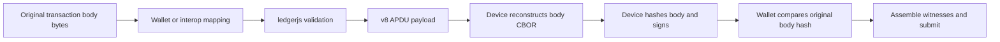
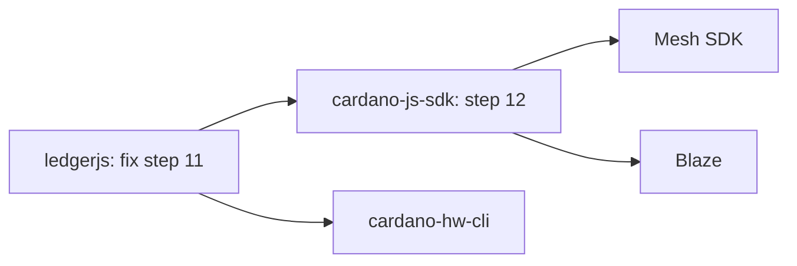

# ledgerjs and the Dijkstra hard fork: diagnosis and remediation

Assessed 2026-11-01 against **cardano-node 11.2.0 / Dijkstra protocol version 12** and **ledgerjs 8.1.0**. This implements the evidence-recording approach of [ADR-2 and ADR-3](ARCHITECTURE.md): reproducible findings, separate from a readiness declaration.

**There is no evidence of a universal Ledger payment outage at the fork. There are confirmed, narrower failures that matter for the critical path.** Legacy stake registration/deregistration fails under Dijkstra; new transaction fields cannot be represented by the current host/device protocol; and some witness encodings assembled by wallets are newly rejected. The fix owner differs for each case.

Reported upstream on 2026-11-06 as [cardano-foundation/ledgerjs-hw-app-cardano#58](https://github.com/cardano-foundation/ledgerjs-hw-app-cardano/issues/58). The issue covers what breaks and how to reproduce it; the remediation and critical-path analysis below were deliberately left out of it.

The investigation contains **27 executed host assertions and 62 executed CLI decoding/hash observations**, with all expectations satisfied. Some expectations are deliberate rejection or silent omission; these numbers are **not compatibility pass rates**. No physical Ledger, Speculos firmware execution, or newly funded node submission was performed. The earlier, separately retained node run supplies software-signed submission controls.

## Scope and exact versions

| Component | Examined identity | What the evidence establishes |
| --- | --- | --- |
| JS library | `8.1.0`, commit `9ce065887bfca145f7a2f46df2ea41b1b47b9640` | Fresh clone of the supplied repository; real, unmodified parser and v8 serializer executed. |
| Node target | `11.2.0`, commit `dac0d7ab2dfdee1f9eda901589e3c6ac8eaa1899` | Official prerelease, published October 28. Node installation and activation of PV12 are separate events. |
| Ledger implementation | `54e24ba4858b5f5cb4c5f6f0adfa3d7cae669b7a`, Dijkstra package `0.4.0.0` | Protocol definitions shipped with that node release. |
| Executed CLI | `11.6.0.0`, release binary reporting node build revision `dac0d7ab…` | Offline Conway/Dijkstra decoding and transaction-body hashing. CLI source dependency is `90cc2b9ae147abacf8169c848ec10dc4296796f6`. |
| Device app source | `LedgerHQ/app-cardano` at `96678fc3b688d0db4ebe3364eda538996e961c96`, declares `8.0.9` | Source review only; not proof of a deployed Ledger Live app or hardware behavior. |

Sources: [node release/dependency table][node-release], [JS package][js-package], [firmware version][firmware-version]. JS package version, device Cardano-app version, Ledger OS version, node version and protocol version must be recorded separately. The README's `cardano-foundation/ledger-app-cardano` link points to an old repository; the active device source above is the relevant v8 comparison. More primary-source detail is in the [protocol reference](#appendix-protocol-reference) below.

The investigation used a temporary clone of ledgerjs at the commit above. The runners and complete results are kept in this repository, so the clone is not needed to read the evidence.

## What breaks, and who fixes it

| Case | Finding | User-visible consequence | Repair owner |
| --- | --- | --- | --- |
| Ordinary ADA/token payments using compatible fields | No blanket encoding break established. Key-hash signers, untagged sets and legacy `true` envelopes remain accepted. | Expected compatible subset, subject to an actual device/hash/submission test. | Wallet/provider must also remain operational. |
| Stake registration/deregistration certificates **0/1** | Host still accepts and serializes them; Dijkstra rejects them. | Signing can appear to succeed, then decoding/submission fails. | Wallet chooses existing certificate **7/8** with explicit deposit/refund; host may add era-aware preflight. |
| Body keys **23–27** | No public/internal model or wire fields; unknown JS properties disappear. | Adapter rejects first, or device signs a projection of the intended body and its witnesses cannot validate the original. | Wallet/interop + ledgerjs + device app. |
| Key-14 **script guards**, or credential-form key guards | Existing `requiredSigners` can encode only the bare-key-hash representation. | Unsupported guard, or body-hash mismatch when a newer representation is projected onto the old one. | Adapter + ledgerjs + device app. |
| Pool-registration BLS extension | Unknown `blsKey` property disappears from host pool params. Firmware has no BLS field. | Extended pool certificate cannot be faithfully signed. Ordinary legacy pool certificate still decodes. | SPO tooling + host/device certificate support. |
| List-form redeemers | Dijkstra decoder rejects; map-form control decodes. | Plutus transaction fails before execution. | Wallet serializer/script-data-hash calculation; ledgerjs receives an already computed hash. |
| Duplicate vkey witnesses, native scripts or datums; wrong-length bootstrap chain code | Paired CLI probes reject in Dijkstra. | Multisigner merge or witness assembly fails. | Wallet/witness assembler, not necessarily device signing. |
| Empty outer multiasset value `[coin, {}]` | Rejected in Dijkstra. Host's empty token bundle matches ADA-only payload; firmware writes plain coin. | External serializer can fail; no demonstrated normal ledgerjs emission of this invalid form. | Wallet CBOR serializer. |
| Submitted outer `is_valid=false` | Rejected; `true` and omission accepted. | Submission decoder failure. | Transaction assembler. |
| V4-related signing | No blanket host rejection established: reference-script bytes are opaque and script-data hash is supplied externally. | New guards/nesting and witness language handling can still block particular V4 transactions. | Trace the particular builder, adapter, device and submission path. |
| Governance proposals, body key **20** | Already absent from the current API/device model. | Unsupported proposal signing predates Dijkstra. | Existing feature gap; do not classify it as a new fork regression. |

Executed evidence: [host results](../content/readiness/dijkstra-runs/2026-11-01-ledgerjs/host-results.json), [paired CLI results](../content/readiness/dijkstra-runs/2026-11-01-ledgerjs/ledger/results.json). Source ownership: [host parser][parser], [v8 wire serializer][serializer], [firmware body keys][firmware-fields], [firmware value encoder][firmware-values], [Dijkstra certificate decoder][cert-decoder], [witness decoder][witness-decoder].

Two corrections prevent overstating the risk:

- **Tag 258 is optional at PV12.** Both encodings decode; `tagCborSets` already selects the device encoding. The host and device must still agree on exact bytes. [Dijkstra sets][sets].
- The newly invalid empty multiasset case is the **outer** map. Empty inner per-policy maps were already rejected in Conway; both CLI controls fail. [Value decoder branches][value-decoder].

## Why an unsupported field can look like successful signing



`parseTransaction()` creates a fresh object containing only known properties. The v8 raw payload and init header independently enumerate those properties and stop at donation. A JavaScript caller can attach `directDeposits`, `accountBalanceIntervals` or other extra properties without an exception; they disappear. TypeScript's declared API does not support those properties either. The diagnostic names represent attempted extensions, **not a proposed or existing Dijkstra API**. [Parser][parser], [types][transaction-types], [wire layout][serializer].

For each of five new-field properties and `guards`, the probe compares the entire parsed request, init bytes and raw transaction bytes with a control. They are identical. It also verifies this under `UNRESTRICTED_TRANSACTION`: expert mode does not extend the transaction schema. Pool registration has the same behavior for an extra BLS field. The prototype BLS bytes are deliberately synthetic; this observation does not validate a BLS proof.

The firmware independently hashes only its known body fields. Therefore adding a JS type, using `as any`, or inventing an APDU flag cannot make the existing device hash/display a new field. This is a coordinated protocol change. [Firmware init][firmware-init], [hash completion][firmware-final], [witness signing][firmware-sign].

The signature binds the **transaction-body hash**, not the outer transaction envelope. If the original body has key 25 and the hardware signs a body without it, attaching the witness to the original should fail signature verification. If the caller instead submits the reduced body, it has changed the requested transaction. Neither outcome is an acceptable fallback. This is a consequence of the hashing paths, not a demonstrated device exploit. [Ledger body identity][body-id], [device signing][firmware-sign].

There is a subtler version with key-only guards. These two accepted Dijkstra fixtures have identical key material but distinct representations and body hashes:

| Key-14 representation | Fixture transaction-body hash |
| --- | --- |
| `[keyhash]`, existing required signer | `15d840f6b7629e5fe003c4b7d8c461ec321bb4bed5745695c282c0fe5fdb4a08` |
| `[[0,keyhash]]`, key credential guard | `a4ce5868f5e117c9841e22cdd0a2d518ea383af9145f3dbed76e8a3a47454cef` |

These are synthetic fixture IDs, not chain transactions. The current firmware emits the first representation. Preserving key identities while changing their CBOR representation is insufficient. [Guard decoder][guard-decoder], [device signer encoding][firmware-signers], [executed comparisons](../content/readiness/dijkstra-runs/2026-11-01-ledgerjs/ledger/results.json).

ledgerjs returns the device's `txHashHex`; its public documentation tells callers to check it. The probe supplies a mock response and confirms that the result is passed through. There is no original transaction-body byte string in this API against which ledgerjs could independently perform that comparison. **The wallet/interop boundary must retain and check the original body hash.** Dijkstra's separate full-transaction `hashTx` for Leios must not replace the body hash being signed. [Return contract][result-contract], [result parsing][result-parser], [full-transaction hash distinction][full-hash].

## Reproduce the findings

The runners do not install dependencies, modify upstream source, need a device, or submit transactions. Python uses the standard library. The host runner loads an already installed TypeScript compiler to execute upstream TS modules; this is transpilation, not a full TypeScript build or the project's complete unit suite.

From this repository:

```sh
node scripts/readiness/ledgerjs-dijkstra/dijkstra-host-probe.cjs \
  <ledgerjs-checkout-at-9ce0658> \
  node_modules/typescript

python3 scripts/readiness/ledgerjs-dijkstra/dijkstra-ledger-probe.py \
  --cli <node-11.2.0>/bin/cardano-cli \
  --out <output-dir>
```

Equivalent runners are in the clone under `scripts/diagnostics/`. For another machine, obtain the repository revision and the official pinned node archive, then use local paths. The existing [devnet recipe](../scripts/readiness/devnet/README.md) records the archive checksum and setup. The host runner records the source revision, every loaded TS file's SHA256, Node and TypeScript versions. The CLI runner records its executable SHA256, version, all command outputs and fixture checksums.

The expected summaries are **27/27 host assertions** and **62/62 CLI observations**. Host observations include reproduced defects, so a green runner establishes the diagnostic baseline. It is expected to need revised assertions after a fix.

To inspect a single rejection:

```sh
<node-11.2.0>/bin/cardano-cli dijkstra transaction txid \
  --tx-file content/readiness/dijkstra-runs/2026-11-01-ledgerjs/ledger/legacy-registration-dijkstra.json \
  --output-text
```

The decoder reports `Certificates without deposits are no longer supported`. The corresponding `deposit-registration-dijkstra.json` decodes and returns a hash. Repeat with `legacy-deregistration`/`deposit-deregistration` or `array-redeemers`/`map-redeemers`.

For every successful decode, the runner compares CLI `txid` with independent Python `hashlib.blake2b(original_body_bytes, digest_size=32)`. **The fixtures are structurally meaningful but unfunded and unsigned; a successful hash is not ledger acceptance.** The V4 script witness contains dummy bytes and the extended pool control uses a null BLS key, so neither proves script execution or BLS proof validation.

One useful unexpected result was retained in the final expectations: this CLI also decodes the three-element ordinary transaction in a Conway text envelope. Do not infer runtime behavior solely from an older CDDL table or the envelope name. The Dijkstra `false` rejection and the accepted `true` control remain distinct.

## Concrete remediation sequence

### 1. Preserve the existing useful signing subset

**Wallet/interop patch:** inspect the original decoded body before converting it into the smaller Ledger request. Reject keys 23–27, unsupported key-14 credential forms, and extended pool certificates until support is advertised. Include pre-existing unsupported fields such as key 20. A check after `parseTransaction()` is too late: the information has already disappeared. A generic `key > 22` check is insufficient because the guards and pool extensions use existing keys.

**Runtime parser hardening:** in a separately reviewed change, reject unknown transaction/pool fields before constructing parsed objects, using `InvalidDataReason` consistently. Cover nested structures and callers' existing metadata conventions; do not silently break legitimate wrapper properties. This adds early diagnostics but cannot detect information already lost by the wallet mapper.

**Signature boundary:** compute/retain the original transaction-body hash before mapping, compare it to `SignedTransactionData.txHashHex`, and verify the returned signatures with the expected public keys before attaching them. On mismatch, abort. Preserve body bytes, output form, ordering, set-tag policy and guard representation. Do not strip fields or re-encode the body after signing.

These are implementation recommendations; no production API or source was changed during this investigation. The exact edit locations are `src/parsing/transaction.ts`, `src/parsing/poolRegistration.ts`, `src/errors/invalidDataReason.ts`, and the consuming wallet's transaction-to-Ledger adapter. The first two parser paths are exercised directly by the retained runner.

### 2. Migrate transactions that become invalid

Use `CertificateType.STAKE_REGISTRATION_CONWAY` and `STAKE_DEREGISTRATION_CONWAY` (7/8), even on Dijkstra. The names reflect when support was introduced. `params.deposit` must be the correct registration deposit or recorded deregistration refund; do not hard-code the probe's 2 ADA. Rebalance fees/value and include the required stake-key witness: the migration is not just changing a numeric tag. Both host forms are already implemented, and the public firmware source encodes them. [Host certificates][host-certs], [device certificate encoders][device-certs].

Wallets must encode redeemers as maps, eliminate prohibited duplicates, use a 32-byte bootstrap chain code, and serialize ADA-only value as a coin. Recalculate affected script-data hashes, execution budgets, fees and body hash **before** signing. Dedupe datum/redeemer-related data with awareness of the script-data hash; treating every witness mutation as harmless is unsafe.

The retained [11.2.0 PV12 devnet log](../content/readiness/dijkstra-runs/2026-11-01/transactions.log) already contains software-signed acceptance of compatible Conway payment, deposit registration, old required-signer and metadata cases, and rejection of deposit-less registration. It supports this migration direction but is not a hardware pass.

For the **cardano-cli → cardano-hw-cli → Ledger** pool-registration workflow, the BLS extension deserves an explicit fixture. The pinned CLI's Dijkstra certificate command requires a BLS signing-key file even though the ledger still accepts the old certificate form. Therefore the CLI workflow can encounter the unsupported extension without an application deliberately opting into a new feature. [CLI option parser][cli-bls].

### 3. Implement new features across the host/device protocol

Agree on capability negotiation before extending serialization. `supportsConway` and the existing broad v8 dispatch are not Dijkstra feature negotiation. Define explicit, versioned capabilities for guards, account operations, nested transactions and BLS certificates; test old device + new host and new device + old host combinations. [Current device capabilities][capabilities].

| Layer | Required work |
| --- | --- |
| Public/internal types | Model every signed field and representation explicitly, including pool BLS extension and ordered credentials. Public API changes require a separate review under the cloned repository's instructions. |
| Parsing | Validate ranges, map order, uniqueness, field combinations, bounds and nesting/resource limits; reject unsupported device capabilities before transport. |
| v8 serialization | Extend init/chunk protocol and raw serialization with an agreed version; preserve byte parity with the device. |
| Device parser/hash builder | Parse and hash every new field, including nested witnesses/auxiliary data committed inside parent bodies; retain the correct top/subtransaction signing semantics. |
| Device policy and display | Make deposits, constraints, guards and nested effects reviewable. An expert-mode toggle alone cannot display fields the firmware never receives. |
| Wallet/interop | Decode new transaction/witness shapes losslessly; generate matching Ledger requests and preserve original hash. |
| Releases | Ship an app build users can actually install, a compatible ledgerjs release, and downstream adapter/dependency updates. A merged JS PR alone does not unblock the chain. |

The inspected firmware changes belong around `src/handler/sign_tx.c` and `src/transaction/tx_hash_builder.*`, plus transaction types, parser, policy and UI modules. Host changes belong in the v8 architecture; the repo identifies v7/Nano S as legacy maintenance. Explicitly determine whether those devices get a limited compatibility profile or require a replacement; this investigation does not promise a v7 Dijkstra feature backport.

V4 work must respect ledger combinations: legacy V1–V3 scripts cannot simply be moved into subtransactions or combined with all new account/guard fields. Account intervals distinguish threaded current balances (26) from starting balances (27). These are semantic requirements, not just serializer fields. See the [protocol reference](#appendix-protocol-reference).

## Apply this to the critical path at `/map/dijkstra`

The user's stated priority is the existing map. The investigation recomputed the page's actual projection using `dijkstraSite()`, `toolStates()` and `fixGraph()`, including its **survey usage >10%, confirmed gap, not dismissed** target selection. The retained [critical-path snapshot](../content/readiness/dijkstra-runs/2026-11-01-ledgerjs/critical-path.json) records the result; the graph is defined in [the page](../app/map/dijkstra/page.tsx) and [fix-graph implementation](../lib/readiness/fix-graph.ts).



Arrows here run from prerequisite to dependent. These are the Ledger-related paths shown by the map, not a claim that every Mesh/Blaze operation calls a Ledger.

| Map component/target | Relevance to this investigation | Other dependencies still shown by the map |
| --- | --- | --- |
| cardano-js-sdk, 28% surveyed usage | First integration priority: its Ledger adapter and body-hash comparison connect this fix to the SDK branch. | Ogmios and Blockfrost, plus its own Dijkstra work; provider dependencies extend to db-sync. |
| Mesh SDK, 37% | Verify the reachable SDK signing flow after the adapter/library/app fixes. | Scalus and Whisky branches remain. |
| Blaze, 11% | Verify whichever SDK hardware-signing integration it actually exposes. Package reach alone does not identify the user operation. | Kupo and migration off Maestro remain. |
| cardano-hw-cli, 14% | Direct file-to-Ledger signing path; test lossless decoding, certificate migration and original body-hash agreement. | CSL and cardano-hw-interop-lib remain. |

Ledger is **step 11**, with no upstream prerequisite recorded for that component, so its investigation/implementation can proceed in parallel with provider work. At that point in the ordered plan its fix adds **Bursa and Yoroi**, bringing the running unlocked total to 69. Those two additions assume earlier fixes have landed; repairing Ledger alone does not clear all their blockers. The page's `critical` flag marks longest dependency chains: it is false on the Ledger node itself, even though the Ledger branch remains necessary for the dependent targets above.

The current map models ledgerjs as one fix with no device-app dependency node. This investigation refines the work **inside that box**: new-field signing requires firmware, host protocol and adapter changes. The 0/1 certificate migration and witness cleanup are separate wallet tasks. No graph/readiness status was silently updated from these diagnostic results.

Direct recorded consumers also include Lace and Nami, alongside SDK, cardano-hw-cli, Bursa and Yoroi. Keep them in regression coverage, but use the map paths above to prioritize the first integration fixtures. [Recorded consumer evidence](../content/readiness/dijkstra/leads.json), [remaining blockers](../content/readiness/dijkstra/unlocks.json).

For example, the examined Bursa signer maps a restricted ordinary-send request and takes only `witnesses` from `signTransaction`, discarding the returned hash. This warrants checking the surrounding backend's original-body/witness verification; it does not by itself prove an arbitrary Dijkstra transaction reaches that signer. [Bursa mapping/signing source][bursa].

## Critical-path validation still required

The current v8 source and compatible transaction subset are the baseline. The map specifies tool priorities, but does not record physical device/Cardano-app combinations. For each selected consumer and supported device/app combination, retain:

1. A funded PV12 test transaction and its **original body CBOR**, plus exact wallet, adapter, ledgerjs, transport, model and app versions. Record the node's era and protocol version; node 11.2 alone is insufficient.
2. A compatible payment, multiasset transfer, 7/8 staking certificate, withdrawal, governance vote, metadata transaction and supported Plutus flow. Verify device-returned body hash, every signature and node acceptance. Test both body set-tag choices where the adapter exposes them.
3. Negative controls for obsolete certificate/redeemer encodings and each unsupported feature. Require an explicit error before a device prompt for unsupported features; never silently downgrade the body.
4. After feature implementation, independent canonical fixtures for keys 23–27, both guard representations and BLS registration. Mutation of every signed field must break signature verification. Exercise node semantic failures, not merely decoding.
5. Cross-era comparison: the same supported workflow before and after PV12. Separately test provider/indexer availability and node-to-client V23 where the consumer uses them; ledgerjs itself communicates with a device, not a Cardano node.

The initial full hardware regression suite remains unrun. The clone's [AGENTS.md](https://github.com/cardano-foundation/ledgerjs-hw-app-cardano/blob/9ce065887bfca145f7a2f46df2ea41b1b47b9640/AGENTS.md) says `Do NOT install anything`; its dependencies, `nvm` setup and a device/emulator were unavailable. Its [testing guide][testing] also says unattended v8 Speculos approval is not yet solved. The standalone diagnostics reused existing tools and exercised unmodified source; they do not replace `test-unit`, the typechecked build, lint or device integration tests for a production patch.

## Appendix: protocol reference

Source detail behind the findings above, merged from the original protocol research note (2026-11-01). Pins are the same as in [Scope and exact versions](#scope-and-exact-versions); the CLI source is `90cc2b9ae147abacf8169c848ec10dc4296796f6`.

### Device source provenance

Sources: [node release and dependency table][p-release], [retained target pins](../content/readiness/dijkstra/changes.json), [JS package][p-js-package], [device version][p-device-version]. The device repository's releases API returned an empty list during this investigation; the source version **does not prove which binary Ledger Live currently distributes**. An actual signing run must record `getVersion()` and the device model, or record the emulator ELF hash and build commit.

The JS README links `cardano-foundation/ledger-app-cardano`, an old Nano S repository whose public API reports its last push in 2021. Current device sources were found under `vacuumlabs/ledger-app-cardano` and its `LedgerHQ/app-cardano` fork. The upstream `develop` head observed was `9602276a64c0e25844bd92ee9eac7c626672a449`; this report uses the LedgerHQ commit above. Do not infer contemporary firmware support from the old README link. [JS README][p-js-readme], [old device repository](https://github.com/cardano-foundation/ledger-app-cardano), [upstream commit](https://github.com/vacuumlabs/ledger-app-cardano/commit/9602276a64c0e25844bd92ee9eac7c626672a449), [LedgerHQ commit](https://github.com/LedgerHQ/app-cardano/commit/96678fc3b688d0db4ebe3364eda538996e961c96).

### Rejected encodings: decoder detail

These are decoder-level findings at the ledger pin. They do not establish that ledgerjs emits every affected encoding; ownership is stated separately.

| Existing encoding | Dijkstra result and source | Reproduction/control | Likely repair owner |
| --- | --- | --- | --- |
| Stake registration certificate `[0, credential]`; deregistration `[1, credential]` | Rejected by `DijkstraTxCert` with `Certificates without deposits are no longer supported`. [Decoder][p-cert-decoder] | Submit otherwise valid transactions differing only in 0 vs 7 and 1 vs 8, with correct deposits, balances and witnesses. | Wallet constructs certificate 7/8; ledgerjs/device already expose deposit-bearing forms. Optional era-aware preflight rejects obsolete forms. |
| Redeemer list `[[tag,index,data,exunits], ...]` | PV12 explicitly rejects list encoding; redeemers must be a nonempty map. [Decoder][p-redeemer-decoder] | Use list vs `{[tag,index]:[data,exunits]}` with matching script-data hashes. | Witness-set builder and script-data-hash calculator. This is not automatically a firmware encoding gap: ledgerjs accepts a precomputed script-data hash. [JS parser][p-js-parser] |
| Output value `[coin, {}]` | PV12 rejects an empty **outer** multiasset map. [Value decoder][p-multiasset-decoder] | Compare the array value with the plain `coin` encoding. | Wallet serializer. Inspected device uses plain `coin` when asset-group count is zero. [Device value encoding][p-device-value] |
| Repeated vkey/bootstrap witnesses, repeated native scripts, repeated datums in witness collections | PV12 enforces no duplicates in these collections. [Witness decoder][p-witness-decoder], [datum decoder][p-datum-decoder], [native-script decoder][p-native-witness-decoder] | Duplicate one entry without changing the body; compare deduplicated witness set. | Wallet witness assembly and multisigner merge code. Test identity rules used by ledger, not merely object identity. |
| Bootstrap witness chain code whose length is not 32 bytes | New explicit PV12 length check. [Chain-code decoder][p-chain-code] | 31/32/33-byte chain-code fixtures distinguish decoding; only a real key and correct signature can establish ledger acceptance. | Bootstrap witness construction. No evidence that normal Ledger-derived witnesses violate this. |
| Submitted transaction `[body,witnesses,false,aux]` | Explicitly rejected; omission or the legacy `true` form decodes. [Transaction decoder][p-tx-decoder] | Decode otherwise identical `false`, `true`, and three-element envelopes. | Transaction assembly/submission. `is_valid` is outside the signed body. |

**Correction to an existing readiness description:** the novel multiasset restriction is the empty outer map. Conway already uses a nonempty decoder for each inner per-policy asset map, and already rejects zero asset quantities. Therefore `{policy: {}}` and zero-valued assets must not be advertised as newly introduced Dijkstra failures. [Side-by-side Conway/Dijkstra decoder branches][p-multiasset-decoder].

Earlier-era labels do not bypass these restrictions. Consensus serializes a mismatched-era transaction and attempts to decode it in the ledger's current era. A failure can surface as an era mismatch rather than the innermost decoder error. [Consensus `matchTx`][p-cross-era]. Existing [11.2.0 devnet transaction evidence](../content/readiness/dijkstra-runs/2026-11-01/transactions.log) reports accepted Conway payments, deposit registration, required signer and metadata transactions, but rejected deposit-less registration. These are prior software-signed controls, **not Ledger-device results**.

### Compatibility preserved at the fork

**CBOR tag 258 is optional.** Dijkstra `set` and `nonempty_set` permit both tagged and untagged arrays; the shared decoder uses `allowTag`. The new witness-set restriction is principally uniqueness, not obligatory tagging. The device already has a `tagCborSets` option. Both host and device must choose the same body bytes; adding tags after signing changes the body hash. [CDDL][p-cddl-sets], [binary decoder][p-set-decoder], [device tag option][p-device-tags].

**Key-hash required signers remain a legal key-14 encoding.** The Dijkstra decoder accepts either a collection of bare key hashes or a collection of credentials, choosing the representation from the first element. It does not permit arbitrary mixtures within the collection. Current firmware emits the bare-key-hash form. It can represent that compatible subset; it cannot represent a script credential guard or preserve a credential-form body supplied by a newer builder. [Guard decoder][p-guards-decoder], [device required-signers encoder][p-device-signers].

**The old four-element submitted transaction with `true` remains accepted in this target.** The three-element format is the new preferred form. Blocks use a different ordering, `[body,witnesses,aux,is_valid]`. Neither envelope change is itself a change to the transaction-body hash signed by the device. Conflating the submitted and block formats gives false incompatibility findings. [Submitted decoder][p-tx-decoder], [block and submitted CDDL][p-cddl-envelope].

The paired CLI investigation also found that CLI 11.6 accepts an ordinary three-element transaction in a Conway text envelope. The pinned Alonzo-family decoder explains this: it treats a missing boolean as `true` and accepts either length. Therefore the outer array length alone is not a reliable era detector, and a test expecting universal Conway rejection of three-element transactions is incorrect for this target. This is a decode result, not proof of ledger validation. [Shared decoder][p-conway-envelope].

**Legacy outputs, withdrawals, treasury/donation and collateral fields still exist.** Dijkstra retains both Alonzo array and Babbage map outputs; keys 5, 13, 16, 17, 18, 19, 21 and 22 keep their established roles. This establishes encoding compatibility, not universal semantic acceptance for arbitrary combinations. The DRep-delegation prerequisite for withdrawals is removed; that relaxes a wallet policy rather than requiring a new signature format. [Body/output CDDL][p-cddl-body], [withdrawal change][p-withdrawal-change].

Withdrawals may be partial in Dijkstra normal mode; aggregate top/sub withdrawals cannot exceed the original account balance. Legacy Plutus mode still requires top-level withdrawals to drain the current balance. Wrong-network withdrawal and pool reward addresses remain invalid, and optional body key 15 must match when present; these network checks predate Dijkstra. Do not report them as new mandatory hard-fork changes. CIP-0134 is a proposal about address URIs, not the source of these network checks. [Withdrawal rules][p-withdrawal-rules], [existing pool rule][p-existing-pool-network], [existing withdrawal/body network checks][p-existing-network], [CIP-0134](https://github.com/cardano-foundation/CIPs/tree/master/CIP-0134).

### New capabilities and their semantics

| Capability | Exact protocol surface | Signing implication |
| --- | --- | --- |
| General guards | Body key 14 also accepts ordered credentials; native script kind 6 requires a guard; redeemer purpose 6 means guarding. | Need typed credentials, order preservation, complete hashing and useful device display. Bare-key-hash guards remain the compatibility subset. |
| Required top-level guards | Key 24: nonempty map from credential to Plutus data or nil. | Every credential and attached datum must be committed to. It cannot be modeled as ordinary `requiredSigners`. |
| Nested transactions | Key 23: ordered nonempty subtransactions containing their own body, witnesses and auxiliary data. | The parent body commits to the nested transaction bytes, including nested witnesses; both top/sub signing semantics and display need implementation. A sub-body is not a top-body with a zero fee. |
| Direct deposits | Key 25: reward-account → coin map. | Sends value to registered accounts; cannot be substituted with a withdrawal, treasury donation or ordinary address output. |
| Balance intervals | Key 26: reward-account → interval; key 27: starting-account intervals on top-level bodies. | These are transaction validity constraints. Removing them changes the signed intent and transaction ID, even if no funds directly move. |
| Plutus V4 | Script language ID 3; script-hash prefix byte 4; witness key 8; auxiliary-data map key 5. | Audit witness construction, reference-script handling, hashes and UI separately. A signer need not execute Plutus to commit to its bytes/hash. Absence of a `PlutusV4` enum in ledgerjs alone does not prove every V4-related signing path fails. |
| BLS pool key | Optional pool-registration extension `[96-byte public key,48-byte proof]`, or nil. | New pool certificate form needs device support. The ledger's optional extension and the CLI's policy requiring a BLS signing key for Dijkstra registration are distinct. |

Sources: [body fields][p-cddl-body], [guards and native scripts][p-cddl-guards], [subtransaction and account forms][p-cddl-subtx], [V4 witnesses and auxiliary data][p-cddl-witnesses], [pool BLS encoding][p-cddl-pool], [conditional BLS proof validation][p-pool-rule], [CLI BLS option parser][p-cli-bls]. The pinned CLI source explicitly uses `Just <$> pBlsSigningKeyFile` for Dijkstra and `pure Nothing` for Conway; the Dijkstra command therefore requires the file option, even though the ledger accepts certificates without the extension.

The account interval forms are `[lower,nil]`, `[nil,upper]`, `[lower,upper]` or an exact coin value. Lower bounds are inclusive; upper bounds exclusive; `[nil,nil]` is rejected. Key 26 checks the threaded current account state, while key 27 checks the original account state; this distinction matters when subtransactions alter balances. The maps are keyed by full reward addresses, including network, **not bare staking credentials**. [Interval decoder][p-interval-codec], [account rules][p-account-rules].

Legacy Plutus V1–V3 scripts remain supported at top level, but context conversion rejects combinations with direct deposits, account-balance intervals, required top-level guards or script-hash guards. Subtransactions cannot execute V1–V3. Updating a signing library cannot relax these on-chain restrictions. Note that the specific legacy-context check reads key 26; do not infer a key-27 prohibition from its error name without following the relevant rule. [Legacy-context restrictions][p-legacy-context], [subtransaction language failure][p-sub-language].

Collateral remains in the top-level body; the subtransaction schema has no fee or collateral fields. The UTxO rule checks batch collateral when either the parent or a subtransaction has redeemers, and execution units/fees aggregate across nested work. A nested-transaction implementation therefore needs more than a generic unknown-field passthrough. [Subtransaction schema][p-cddl-subtx], [batch collateral and balance checks][p-utxo-rules].

### Body hash versus full-transaction hash

The device reconstructs CBOR for the body and finishes Blake2b-256, then signs that transaction hash with each selected witness path. Dijkstra still defines the transaction ID as the hash of body bytes and retains those bytes through `MemoBytes`. Consequently, signing a projection that omitted an account constraint or subtransaction produces a witness for another body. Attaching that witness to the complete original body should fail signature verification; submitting the projected body instead can remove the caller's intended constraint. This is a source-derived consequence, not a claim of a demonstrated hardware attack. [Device finalization][p-device-finalize], [device witness signing][p-device-sign], [ledger transaction ID][p-tx-id], [memoized body hash][p-body-hash].

There is also a Dijkstra `hashTx` covering body, witnesses, auxiliary data and phase-2 validity for complete-transaction identification, used for Leios. Its source explicitly distinguishes it from `txId`. **Do not change the hardware signing payload to that full-transaction hash.** [Full-transaction hash][p-full-tx-hash].

[node-release]: https://github.com/IntersectMBO/cardano-node/releases/tag/11.2.0
[js-package]: https://github.com/cardano-foundation/ledgerjs-hw-app-cardano/blob/9ce065887bfca145f7a2f46df2ea41b1b47b9640/package.json
[firmware-version]: https://github.com/LedgerHQ/app-cardano/blob/96678fc3b688d0db4ebe3364eda538996e961c96/Makefile#L33
[parser]: https://github.com/cardano-foundation/ledgerjs-hw-app-cardano/blob/9ce065887bfca145f7a2f46df2ea41b1b47b9640/src/parsing/transaction.ts#L570
[transaction-types]: https://github.com/cardano-foundation/ledgerjs-hw-app-cardano/blob/9ce065887bfca145f7a2f46df2ea41b1b47b9640/src/types/public.ts#L1800
[serializer]: https://github.com/cardano-foundation/ledgerjs-hw-app-cardano/blob/9ce065887bfca145f7a2f46df2ea41b1b47b9640/src/interactions/v8/serialization/tx.ts#L552
[firmware-fields]: https://github.com/LedgerHQ/app-cardano/blob/96678fc3b688d0db4ebe3364eda538996e961c96/src/transaction/tx_hash_builder.h#L17
[firmware-values]: https://github.com/LedgerHQ/app-cardano/blob/96678fc3b688d0db4ebe3364eda538996e961c96/src/transaction/tx_hash_builder.c#L175
[firmware-init]: https://github.com/LedgerHQ/app-cardano/blob/96678fc3b688d0db4ebe3364eda538996e961c96/src/handler/sign_tx.c#L285
[firmware-final]: https://github.com/LedgerHQ/app-cardano/blob/96678fc3b688d0db4ebe3364eda538996e961c96/src/transaction/tx_hash_builder.c#L2448
[firmware-sign]: https://github.com/LedgerHQ/app-cardano/blob/96678fc3b688d0db4ebe3364eda538996e961c96/src/handler/sign_tx.c#L642
[firmware-signers]: https://github.com/LedgerHQ/app-cardano/blob/96678fc3b688d0db4ebe3364eda538996e961c96/src/transaction/tx_hash_builder.c#L2056
[cert-decoder]: https://github.com/IntersectMBO/cardano-ledger/blob/54e24ba4858b5f5cb4c5f6f0adfa3d7cae669b7a/eras/dijkstra/impl/src/Cardano/Ledger/Dijkstra/TxCert.hs#L239
[witness-decoder]: https://github.com/IntersectMBO/cardano-ledger/blob/54e24ba4858b5f5cb4c5f6f0adfa3d7cae669b7a/eras/alonzo/impl/src/Cardano/Ledger/Alonzo/TxWits.hs#L566
[sets]: https://github.com/IntersectMBO/cardano-ledger/blob/54e24ba4858b5f5cb4c5f6f0adfa3d7cae669b7a/eras/dijkstra/impl/cddl/data/dijkstra.cddl#L144
[value-decoder]: https://github.com/IntersectMBO/cardano-ledger/blob/54e24ba4858b5f5cb4c5f6f0adfa3d7cae669b7a/eras/mary/impl/src/Cardano/Ledger/Mary/Value.hs#L331
[body-id]: https://github.com/IntersectMBO/cardano-ledger/blob/54e24ba4858b5f5cb4c5f6f0adfa3d7cae669b7a/libs/cardano-ledger-core/src/Cardano/Ledger/Core.hs#L672
[guard-decoder]: https://github.com/IntersectMBO/cardano-ledger/blob/54e24ba4858b5f5cb4c5f6f0adfa3d7cae669b7a/eras/dijkstra/impl/src/Cardano/Ledger/Dijkstra/TxBody.hs#L1659
[result-contract]: https://github.com/cardano-foundation/ledgerjs-hw-app-cardano/blob/9ce065887bfca145f7a2f46df2ea41b1b47b9640/src/types/public.ts#L1537
[result-parser]: https://github.com/cardano-foundation/ledgerjs-hw-app-cardano/blob/9ce065887bfca145f7a2f46df2ea41b1b47b9640/src/interactions/v8/signTx.ts#L48
[full-hash]: https://github.com/IntersectMBO/cardano-ledger/blob/54e24ba4858b5f5cb4c5f6f0adfa3d7cae669b7a/eras/dijkstra/impl/src/Cardano/Ledger/Dijkstra/Tx.hs#L440
[host-certs]: https://github.com/cardano-foundation/ledgerjs-hw-app-cardano/blob/9ce065887bfca145f7a2f46df2ea41b1b47b9640/src/parsing/certificate.ts#L73
[device-certs]: https://github.com/LedgerHQ/app-cardano/blob/96678fc3b688d0db4ebe3364eda538996e961c96/src/transaction/tx_hash_builder.c#L916
[capabilities]: https://github.com/cardano-foundation/ledgerjs-hw-app-cardano/blob/9ce065887bfca145f7a2f46df2ea41b1b47b9640/src/validation/deviceCapabilities.ts#L34
[bursa]: https://github.com/blinklabs-io/bursa/blob/77e998911b238d64a71280f21c0334a4081f0fbf/ui/web/src/hw/ledger.ts#L127
[testing]: https://github.com/cardano-foundation/ledgerjs-hw-app-cardano/blob/9ce065887bfca145f7a2f46df2ea41b1b47b9640/doc/testing.md
[cli-bls]: https://github.com/IntersectMBO/cardano-cli/blob/90cc2b9ae147abacf8169c848ec10dc4296796f6/cardano-cli/src/Cardano/CLI/EraBased/StakePool/Option.hs#L103
[p-release]: https://github.com/IntersectMBO/cardano-node/releases/tag/11.2.0
[p-js-package]: https://github.com/cardano-foundation/ledgerjs-hw-app-cardano/blob/9ce065887bfca145f7a2f46df2ea41b1b47b9640/package.json#L3
[p-js-readme]: https://github.com/cardano-foundation/ledgerjs-hw-app-cardano/blob/9ce065887bfca145f7a2f46df2ea41b1b47b9640/README.md#L5
[p-js-parser]: https://github.com/cardano-foundation/ledgerjs-hw-app-cardano/blob/9ce065887bfca145f7a2f46df2ea41b1b47b9640/src/parsing/transaction.ts#L570-L708
[p-device-version]: https://github.com/LedgerHQ/app-cardano/blob/96678fc3b688d0db4ebe3364eda538996e961c96/Makefile#L32-L36
[p-device-value]: https://github.com/LedgerHQ/app-cardano/blob/96678fc3b688d0db4ebe3364eda538996e961c96/src/transaction/tx_hash_builder.c#L175-L200
[p-device-tags]: https://github.com/LedgerHQ/app-cardano/blob/96678fc3b688d0db4ebe3364eda538996e961c96/src/transaction/tx_hash_builder.c#L67-L72
[p-device-signers]: https://github.com/LedgerHQ/app-cardano/blob/96678fc3b688d0db4ebe3364eda538996e961c96/src/transaction/tx_hash_builder.c#L2056-L2092
[p-device-finalize]: https://github.com/LedgerHQ/app-cardano/blob/96678fc3b688d0db4ebe3364eda538996e961c96/src/transaction/tx_hash_builder.c#L2448-L2456
[p-device-sign]: https://github.com/LedgerHQ/app-cardano/blob/96678fc3b688d0db4ebe3364eda538996e961c96/src/handler/sign_tx.c#L642-L654
[p-cddl-envelope]: https://github.com/IntersectMBO/cardano-ledger/blob/54e24ba4858b5f5cb4c5f6f0adfa3d7cae669b7a/eras/dijkstra/impl/cddl/data/dijkstra.cddl#L3-L24
[p-cddl-body]: https://github.com/IntersectMBO/cardano-ledger/blob/54e24ba4858b5f5cb4c5f6f0adfa3d7cae669b7a/eras/dijkstra/impl/cddl/data/dijkstra.cddl#L116-L154
[p-cddl-sets]: https://github.com/IntersectMBO/cardano-ledger/blob/54e24ba4858b5f5cb4c5f6f0adfa3d7cae669b7a/eras/dijkstra/impl/cddl/data/dijkstra.cddl#L144
[p-cddl-guards]: https://github.com/IntersectMBO/cardano-ledger/blob/54e24ba4858b5f5cb4c5f6f0adfa3d7cae669b7a/eras/dijkstra/impl/cddl/data/dijkstra.cddl#L398-L456
[p-cddl-subtx]: https://github.com/IntersectMBO/cardano-ledger/blob/54e24ba4858b5f5cb4c5f6f0adfa3d7cae669b7a/eras/dijkstra/impl/cddl/data/dijkstra.cddl#L824-L860
[p-cddl-witnesses]: https://github.com/IntersectMBO/cardano-ledger/blob/54e24ba4858b5f5cb4c5f6f0adfa3d7cae669b7a/eras/dijkstra/impl/cddl/data/dijkstra.cddl#L862-L934
[p-cddl-pool]: https://github.com/IntersectMBO/cardano-ledger/blob/54e24ba4858b5f5cb4c5f6f0adfa3d7cae669b7a/eras/dijkstra/impl/cddl/data/dijkstra.cddl#L460-L483
[p-cert-decoder]: https://github.com/IntersectMBO/cardano-ledger/blob/54e24ba4858b5f5cb4c5f6f0adfa3d7cae669b7a/eras/dijkstra/impl/src/Cardano/Ledger/Dijkstra/TxCert.hs#L239-L249
[p-redeemer-decoder]: https://github.com/IntersectMBO/cardano-ledger/blob/54e24ba4858b5f5cb4c5f6f0adfa3d7cae669b7a/eras/alonzo/impl/src/Cardano/Ledger/Alonzo/TxWits.hs#L566-L597
[p-multiasset-decoder]: https://github.com/IntersectMBO/cardano-ledger/blob/54e24ba4858b5f5cb4c5f6f0adfa3d7cae669b7a/eras/mary/impl/src/Cardano/Ledger/Mary/Value.hs#L331-L352
[p-witness-decoder]: https://github.com/IntersectMBO/cardano-ledger/blob/54e24ba4858b5f5cb4c5f6f0adfa3d7cae669b7a/eras/alonzo/impl/src/Cardano/Ledger/Alonzo/TxWits.hs#L630-L658
[p-datum-decoder]: https://github.com/IntersectMBO/cardano-ledger/blob/54e24ba4858b5f5cb4c5f6f0adfa3d7cae669b7a/eras/alonzo/impl/src/Cardano/Ledger/Alonzo/TxWits.hs#L344-L361
[p-native-witness-decoder]: https://github.com/IntersectMBO/cardano-ledger/blob/54e24ba4858b5f5cb4c5f6f0adfa3d7cae669b7a/eras/alonzo/impl/src/Cardano/Ledger/Alonzo/TxWits.hs#L700-L716
[p-chain-code]: https://github.com/IntersectMBO/cardano-ledger/blob/54e24ba4858b5f5cb4c5f6f0adfa3d7cae669b7a/libs/cardano-ledger-core/src/Cardano/Ledger/Keys/Bootstrap.hs#L79-L85
[p-tx-decoder]: https://github.com/IntersectMBO/cardano-ledger/blob/54e24ba4858b5f5cb4c5f6f0adfa3d7cae669b7a/eras/dijkstra/impl/src/Cardano/Ledger/Dijkstra/Tx.hs#L147-L169
[p-conway-envelope]: https://github.com/IntersectMBO/cardano-ledger/blob/54e24ba4858b5f5cb4c5f6f0adfa3d7cae669b7a/eras/alonzo/impl/src/Cardano/Ledger/Alonzo/Tx.hs#L587-L604
[p-withdrawal-rules]: https://github.com/IntersectMBO/cardano-ledger/blob/54e24ba4858b5f5cb4c5f6f0adfa3d7cae669b7a/eras/dijkstra/impl/src/Cardano/Ledger/Dijkstra/Rules/Entities.hs#L341-L430
[p-existing-pool-network]: https://github.com/IntersectMBO/cardano-ledger/blob/54e24ba4858b5f5cb4c5f6f0adfa3d7cae669b7a/eras/shelley/impl/src/Cardano/Ledger/Shelley/Rules/Pool.hs#L229-L243
[p-existing-network]: https://github.com/IntersectMBO/cardano-ledger/blob/54e24ba4858b5f5cb4c5f6f0adfa3d7cae669b7a/eras/alonzo/impl/src/Cardano/Ledger/Alonzo/Rules/Utxo.hs#L567-L573
[p-set-decoder]: https://github.com/IntersectMBO/cardano-ledger/blob/54e24ba4858b5f5cb4c5f6f0adfa3d7cae669b7a/libs/cardano-ledger-binary/src/Cardano/Ledger/Binary/Decoding/Decoder.hs#L1054-L1097
[p-guards-decoder]: https://github.com/IntersectMBO/cardano-ledger/blob/54e24ba4858b5f5cb4c5f6f0adfa3d7cae669b7a/eras/dijkstra/impl/src/Cardano/Ledger/Dijkstra/TxBody.hs#L1659-L1679
[p-withdrawal-change]: https://github.com/IntersectMBO/cardano-ledger/blob/54e24ba4858b5f5cb4c5f6f0adfa3d7cae669b7a/eras/dijkstra/impl/CHANGELOG.md#L319
[p-interval-codec]: https://github.com/IntersectMBO/cardano-ledger/blob/54e24ba4858b5f5cb4c5f6f0adfa3d7cae669b7a/eras/dijkstra/impl/src/Cardano/Ledger/Dijkstra/Scripts.hs#L670-L696
[p-account-rules]: https://github.com/IntersectMBO/cardano-ledger/blob/54e24ba4858b5f5cb4c5f6f0adfa3d7cae669b7a/eras/dijkstra/impl/src/Cardano/Ledger/Dijkstra/Rules/Entities.hs#L276-L314
[p-pool-rule]: https://github.com/IntersectMBO/cardano-ledger/blob/54e24ba4858b5f5cb4c5f6f0adfa3d7cae669b7a/eras/dijkstra/impl/src/Cardano/Ledger/Dijkstra/Rules/Pool.hs#L253-L263
[p-cli-bls]: https://github.com/IntersectMBO/cardano-cli/blob/90cc2b9ae147abacf8169c848ec10dc4296796f6/cardano-cli/src/Cardano/CLI/EraBased/StakePool/Option.hs#L103-L142
[p-legacy-context]: https://github.com/IntersectMBO/cardano-ledger/blob/54e24ba4858b5f5cb4c5f6f0adfa3d7cae669b7a/eras/dijkstra/impl/src/Cardano/Ledger/Dijkstra/TxInfo.hs#L486-L519
[p-sub-language]: https://github.com/IntersectMBO/cardano-ledger/blob/54e24ba4858b5f5cb4c5f6f0adfa3d7cae669b7a/eras/dijkstra/impl/src/Cardano/Ledger/Dijkstra/TxInfo.hs#L521-L536
[p-utxo-rules]: https://github.com/IntersectMBO/cardano-ledger/blob/54e24ba4858b5f5cb4c5f6f0adfa3d7cae669b7a/eras/dijkstra/impl/src/Cardano/Ledger/Dijkstra/Rules/Utxo.hs#L345-L387
[p-tx-id]: https://github.com/IntersectMBO/cardano-ledger/blob/54e24ba4858b5f5cb4c5f6f0adfa3d7cae669b7a/libs/cardano-ledger-core/src/Cardano/Ledger/Core.hs#L672-L675
[p-body-hash]: https://github.com/IntersectMBO/cardano-ledger/blob/54e24ba4858b5f5cb4c5f6f0adfa3d7cae669b7a/eras/dijkstra/impl/src/Cardano/Ledger/Dijkstra/TxBody.hs#L1056-L1066
[p-full-tx-hash]: https://github.com/IntersectMBO/cardano-ledger/blob/54e24ba4858b5f5cb4c5f6f0adfa3d7cae669b7a/eras/dijkstra/impl/src/Cardano/Ledger/Dijkstra/Tx.hs#L440-L470
[p-cross-era]: https://github.com/IntersectMBO/ouroboros-consensus/blob/952b7020172dd7ab135b66e736da070309b47909/ouroboros-consensus/src/ouroboros-consensus/Ouroboros/Consensus/HardFork/Combinator/InjectTxs.hs#L215-L247
